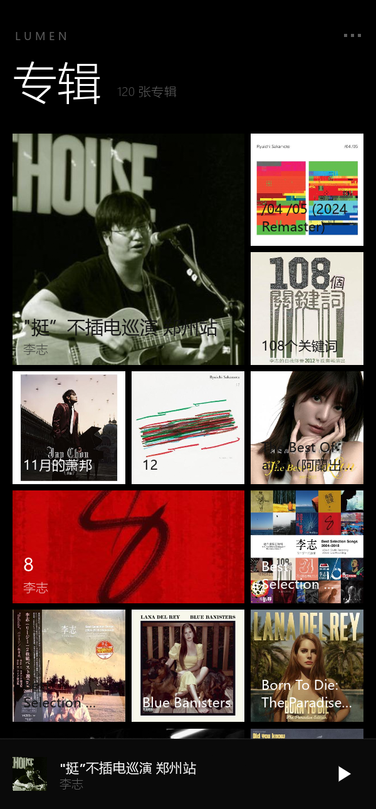
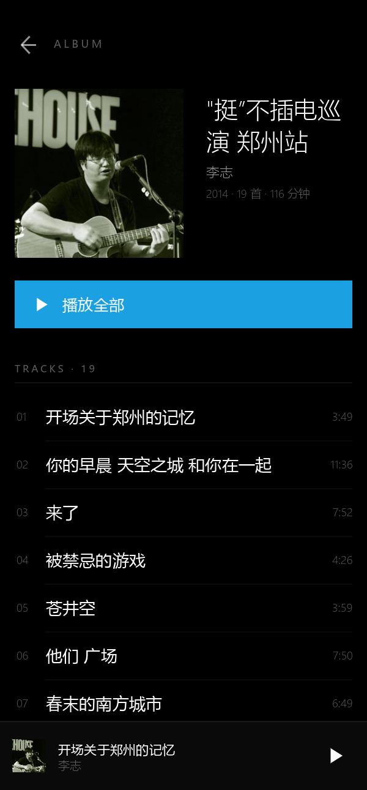
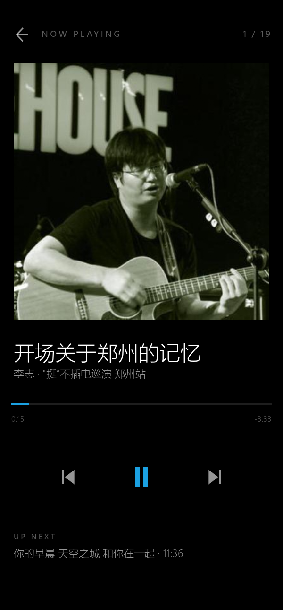
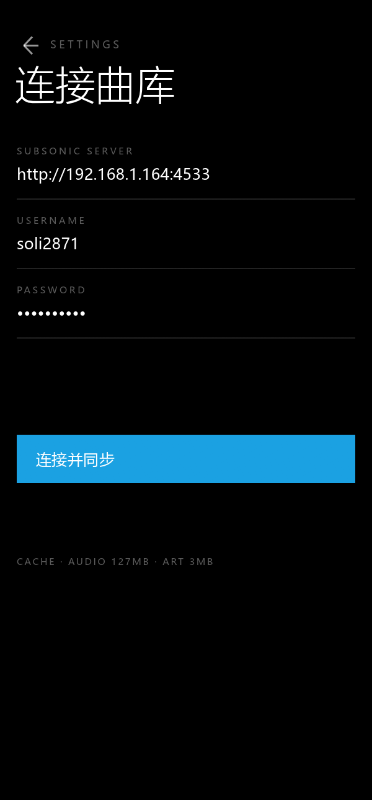

# Lumen · 纯 Rust 的 Android 音乐播放器（Metro 版）

> 完整项目说明见 **[大纲.md](大纲.md)**（结构、架构、实测数据、构建步骤、音频格式支持、已知问题）。

本地音乐播放器，曲库来自 NAS 上的 **Navidrome**（OpenSubsonic）。
界面不是常见的"音乐 App"，而是 **Windows Phone 8 的 Metro 语言**：纯黑舞台、锐角瓷砖、MiSans 细体、唯一一个强调色。

**整个曲库平铺在首页**——等宽 1×1 方砖拼成一堵墙，一屏十几张封面，上下滑就是翻曲库。
点一张砖进专辑页，点曲目进播放页。UI、网络、音频全部用 Rust 自绘（egui + 手写几何），
通过 **GameActivity** 加载 `libapp.so`；为获得完整的 IME 软键盘支持，引入了 androidx 与 games-activity 两个 Java 壳依赖。

| 首页（瓷砖墙） | 专辑 | 播放 | 登录 |
| --- | --- | --- | --- |
|  |  |  |  |

## Metro 的三条规矩

1. **零圆角、零投影、零渐变装饰**——层级靠留白、字重和一条 1px 的细线；
2. **颜色只有黑 / 白 / 灰 / 强调色（Cyan #1BA1E2）**，强调色只出现在进度、当前曲目、主按钮上；
3. **大字用细体（MiSans Light），小标题用大写 + 字距**——三档字重（Light / Regular / Demibold）
   全部使用小米 **MiSans**（嵌入 APK，不依赖系统字体，免费商用授权）。

几个具体实现：

* **瓷砖墙**：列数 = 屏宽 / 215pt（夹在 3~6，Pixel 10a 竖屏 3 列），
  等宽 1×1 方砖按"最低落点优先、并列取最左"填充，砖缝恒为 6pt，不留洞；
* **进场**：瓷砖绕自身中线从 −90° 翻到 0°（turnstile），相邻两块错开 30ms，翻完文字才淡入；
* **标题反色**：不铺任何遮罩。取封面左下角（文字所在的那块）采样，
  统计"白字会糊"和"黑字会糊"的像素占比，谁少用谁；方形砖和 2:1 宽砖分开量，
  因为宽砖会把封面上下各裁掉 1/4；
* **滚动**：自己算惯性物理（拖拽 1:1 跟手，松手按速度甩一段、指数衰减），
  不用 ScrollArea——这样"按下就拖"和"点一下开专辑"可以共存，不必抢手势；
* **标题栏钉住**：瓷砖裁剪到标题栏以下，标题和右上角「已登录」状态标识滑到哪儿都在。

```
src/
├── app.rs         三个页面 + 登录界面 + 滚动/手势 + 播放状态 + 封面窗口
├── metro.rs       Metro 设计 token 与绘制原语（瓷砖、细线图标、字距标题）
├── theme.rs       字体：MiSans 三档（Light/Regular/Demibold），嵌入 APK
├── ime.rs         Android 软键盘 → egui ImeEvent 的桥（预编辑 / 提交 / 删除）
├── model.rs       曲库模型 + 程序化封面 + 标题反色采样
├── remote.rs      Navidrome 后台线程（元数据 + 封面 + 歌词 + scrobble）
├── subsonic.rs    OpenSubsonic 客户端（token+salt 认证）
├── audio.rs       Rodio + Symphonia 播放引擎
├── range_source.rs 可 Seek 的 HTTP Range 源（后台线程预读）
├── cache.rs       音频 / 封面两级磁盘 LRU
├── settings.rs    服务器连接设置 + 密码加密存储
├── safe_area.rs   刘海安全区 / 帧率 / IME / 退出（JNI）
├── eventlog.rs    持久化事件日志（脱敏）
├── geometry.rs    纯几何 / 物理（惯性滚动、歌词排版估算）
├── anim.rs        弹簧与缓动
├── lib.rs         Android 入口（GameActivity）
└── main.rs        桌面入口（电脑上按手机比例预览）
```

## 1. 已经装好的环境

| 组件 | 版本 | 位置 |
| --- | --- | --- |
| Rust (rustup) | 1.100.0 | `~\.cargo`、`~\.rustup`（标准位置） |
| Android 编译目标 | aarch64-linux-android（只保留 arm64） | `rustup target list --installed` |
| 主机链接器 | MinGW-w64 gcc 16.2.0（MSYS2） | `C:\toolchains\msys64\mingw64\bin` |
| JDK | Temurin 17.0.21 | `C:\toolchains\jdk17` |
| Gradle | 8.11.1 | `C:\toolchains\gradle` |
| Android SDK | platform 35 / build-tools 35.0.1 / platform-tools 37.0.1 | `C:\toolchains\android-sdk` |
| Android NDK | 27.2.12479018（r27c） | `C:\toolchains\android-sdk\ndk\27.2.12479018` |
| cargo-ndk | 4.1.2 | `~\.cargo\bin\cargo-ndk.exe` |

环境变量已写入**用户级**环境变量，**新开一个终端**即可直接用 `cargo`、`java`、`gradle`、`adb`、`cargo ndk`。
已经开着的终端先执行一次：`. .\env.ps1`

## 2. 构建与运行

```powershell
.\build.cmd              # debug APK（可直接装）
.\build.cmd -Release     # release APK（LTO + strip）
.\install-apk.cmd        # 装到已连接的手机并启动
cargo run --bin app-desktop   # 电脑上按手机比例预览
```

改完都要装到手机验证（**Pixel 10a**；USB 调试直接 `adb -s <serial>`，无线调试先 `adb connect <ip>:5555`）。桌面预览时可以直接落到某一页（省得每次手点）：

```bash
LUMEN_PAGE=album   cargo run --bin app-desktop   # 专辑页
LUMEN_PAGE=playing cargo run --bin app-desktop   # 播放页
LUMEN_PAGE=setup   cargo run --bin app-desktop   # 连接设置
```

产物在 `dist\`。手动等价命令：

```powershell
cargo ndk -t arm64-v8a -o android/app/src/main/jniLibs build --release
cd android; gradle assembleDebug
```

## 3. 测试设备

只保留一台目标机：**Google Pixel 10a**（arm64-v8a，Android 16）。
档案见 [`docs/device.md`](docs/device.md)，每次改完都装这台验证；其余机型 / 平板 / 模拟器不再维护。

## 4. 改代码

- **界面**：`src/app.rs`，每个页面一对方法（`home_input` / `draw_home`、`album_input` / `draw_album`、
  `playing_input` / `draw_playing`、`setup_input` / `draw_setup`）——布局算一次，交互和绘制共用。
- **视觉语言**：`src/metro.rs`（颜色、细线图标、字距标题、翻砖透视），尺寸都乘 `k`（屏高/760）。
- **字体**：`src/theme.rs` 三档字重全用 MiSans（嵌入 `assets/fonts/`）。
- **手感**：翻页是 `nav` 弹簧（0 首页 / 1 专辑 / 2 播放），滚动是 `step_inertia` 惯性物理
  （拖拽 1:1、松手速度接手、指数衰减，首页与曲目列表共用）。
- **真实数据**：启动即从 Navidrome（`http://192.0.2.10:4533`）分页拉 `getAlbumList2`（500/页循环）与封面。
- **包名**：`android/app/build.gradle.kts` 里的 `applicationId` / `namespace`。

## 5. 已知限制

播放页只做专辑内顺序播放，还没有队列 / 随机 / 循环开关；后台播放需要 MediaSession
（建议加一个 ~50 行的 Kotlin 服务壳，或接受"仅前台播放"）。

## 音频

见 [docs/audio-arch.md](docs/audio-arch.md)：Rodio（cpal → AAudio）+ Symphonia 解码，OpenSubsonic 取流。真机已验证 48000 Hz / 2 ch 输出。

## 已接入真实曲库（Navidrome / OpenSubsonic）

* 服务器 `http://192.0.2.10:4533`（Navidrome 0.64.2），token + salt 认证（`t=md5(pass+salt)`），不传明文；
* 启动分页拉 `getAlbumList2`（500/页循环，不再限于 120 张）+ 后台线程逐张 `getCoverArt` 解码上纹理；
* 点专辑 → `getAlbum` 取曲目 → `stream` 的 HTTP Range 流直接交给 Rodio/Symphonia（真机实测 38 MB 文件、拖拽 seek 到 12:49/15:57）；
* 播放位置由音频引擎回报，进度条可点可拖，seek 用非阻塞淡入防咔哒。

凭据存在应用私有目录的 `settings.json`（桌面上是临时目录 `lumen/settings.json`），密码用 AES-GCM 加密后落盘，不再明文。
